# Greenburg

*English translation of the Italian rulebook, [regolamento.md](regolamento.md). In case of doubt the Italian text prevails.*

## 1. Introduction

Greenburg is a board game for 3 or 4 players, lasting at most 20 minutes, recommended for ages 10 and up. Each player governs a district of an imaginary city, Greenburg, which at the start of the game is polluted, sealed under tarmac and concrete, and connected by roads and railways in poor condition. Over six years of play, from 2025 to 2030, the players transform their districts by replacing polluting surfaces and plants with green infrastructure, sustainable mobility and renewable energy, retrofitting buildings and renewing the transport networks that cross the city.

The game works by subtraction. Each district starts with a fixed level of emissions, and every intervention removes a source of emissions. Emissions work as a flow: at the end of every year the city emits according to what is still left to transform, and each player scores points in proportion to the reduction already achieved in their own district. An intervention made in 2025 scores for six years, the same intervention made in 2029 for two; points therefore measure the clean air the player has given the city over time.

The game has two overlapping goals. The cooperative goal is to bring the emissions of the whole city below a threshold by the end of 2030; if the city fails, every player's score is halved. The competitive goal is to collect more impact points than the others. The two shared networks, road and railway, cross every district and benefit the whole city only once each player has renewed their own section.

## 2. Components

Quantities refer to the 4-player game; with 3 players use the components shown in the corresponding column.

| Component | Total quantity | In use with 3 players | In use with 4 players |
| --- | --- | --- | --- |
| District tiles | 4 | 3 | 4 |
| Grey land tiles (12 types, 2 copies each) | 24 | 18, drawn at random | 24 |
| Double-sided building tiles (4 types) | 8 | 6, drawn at random | 8 |
| Double-sided road tiles | 4 | 3 | 4 |
| Double-sided railway tiles | 4 | 3 | 4 |
| Infrastructure tiles (3 families, 11 subjects) | 36 | 36 | 36 |
| Investment cards (6 types, 1 copy each) | 6 | 4, drawn at random | 5, drawn at random |
| Role cards | 5 | 5 | 5 |
| Network completed tokens (road, railway) | 2 | 2 | 2 |
| Key to the City token (first player) | 1 | 1 | 1 |
| Year track (2025-2030) with Year marker | 1 | 1 | 1 |
| City emissions track, with threshold | 1 | 1 | 1 |
| Personal emissions tracks (0-14) with cube | 4 | 3 | 4 |
| 0-100 score track with pawns | 1 + 4 pawns | 1 + 3 pawns | 1 + 4 pawns |
| Credits (1 and 5 coins) | 40 of 1, 10 of 5 | all | all |

Budget is measured in credits. Grey land tiles, buildings on their grey side and network tiles on their run-down side are the only sources of emissions in the game.

## 3. The board

The board is not printed in a single piece. It is assembled in the middle of the table by placing the district tiles and the network tiles side by side to form a closed ring: the districts occupy the corners, the network tiles the sides. Each side holds two parallel tiles, the road on the outside of the ring and the railway on the inside, so that together the roads form a ring road and the railways a rail belt crossing every district.

Clockwise from the top left corner, the four districts are: Castle, Bridge, Market, Station. With three players use Castle, Bridge and Market, laid out in a triangle.

Each district owns the two network tiles linking it to the next district clockwise, that is the ones the player, sitting behind their district and facing the middle of the table, sees on their left. The Castle therefore owns the top side, the Bridge the right side, the Market the bottom side and the Station the left side. All network tiles start on their run-down side; when a player renews a section, they flip the road or railway tile on their left, which from then on shows its renewed side.

Layout for 4 players (R = road, RW = railway, the name in brackets is the owning district):

```
[CASTLE] ====== R (Castle) ======= [BRIDGE]
    ||    ------ RW (Castle) ------    ||
    ||  |                          |   ||
 R (Station)  RW (Station)  RW (Bridge)  R (Bridge)
    ||  |          CENTRE          |   ||
    ||    ------ RW (Market) ------    ||
[STATION] ====== R (Market) ====== [MARKET]
```

The middle of the ring holds the display of infrastructure tiles, the five role cards, the face-up Investment cards, the two Network completed tokens, the year track and the city emissions track. In front of each player are their credit supply and their personal emissions track; the score track goes to one side.

## 4. Tile catalogue

### 4.1 General art direction

All illustrations share the same top-down view with a slight isometric perspective, tilted by about 30 degrees, so that tiles placed side by side form a single view of the city. The style is illustrative, with flat colours, soft shadows and thin outlines, never photographic. Human figures are small and stylised, without recognisable faces, and no real brands appear.

Tiles showing the polluted state (grey tiles, buildings on their grey side, networks on their run-down side) use a palette of greys, dull ochres and browns, with a veil of yellowish haze in the upper corner and small puffs of dark smoke wherever there is a source of emissions. Transformed tiles (infrastructure, decarbonised buildings, renewed networks) use full greens, light blues, pale wood and a warm afternoon light under a clear sky. The contrast between the two palettes must make it obvious at a glance, on the table, how much of each district has already been transformed.

At the bottom, each tile has a caption band taking up about a fifth of its height, with the name in small caps and, below it, the printed text in smaller italics. Game values appear as icons in the upper corners:

- **Emission**: dark grey cloud with the number in white, top left corner;
- **Cost**: gold coin with the number, top left corner;
- **Income**: green coin with a small upward arrow and the number, top right corner;
- **Points**: green leaf with the number;
- **Network bonus**: crossed-out cloud with the label −1.

### 4.2 District tiles

Each district tile is a large square tile divided into a 3 × 3 grid. The central square holds the crest and the name; the eight squares around it are spaces where the game's tiles are placed, as follows:

```
[ T1 ] [ T2 ] [ T3 ]
[ E1 ] [CREST] [ E2 ]
[ T4 ] [ T5 ] [ T6 ]
```

Squares T1-T6 are land spaces and hold the grey land tiles, then the infrastructure. Squares E1 and E2 are building spaces and hold the building tiles. The spaces are printed with a thin border and a small code in the corner, visible only while the space is empty.

| Image | ID | Name | Crest | Printed text |
| --- | --- | --- | --- | --- |
| 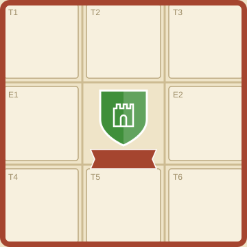 | mun\_castello | Castle District | Crenellated tower | The oldest district, grown up around the walls. |
| 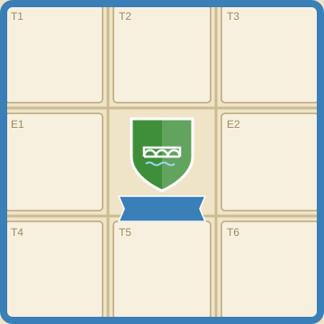 | mun\_ponte | Bridge District | Arched bridge over a stream | The district that joins the two banks of the stream. |
| 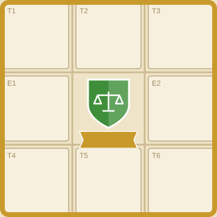 | mun\_mercato | Market District | Scales | The district of workshops and weekly markets. |
| 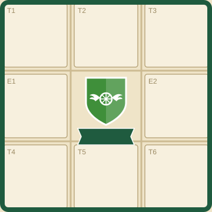 | mun\_stazione | Station District | Winged wheel | The district that grew up around the railway yard. |

**Art.** The background of each district tile is a top-down town plan in the neutral tones of old paper, with a grid of thin streets running between the squares and joining the network tiles at the edges. The central square bears a simple two-colour heraldic shield (green and white for every district, to show they belong to the same city), with the district's own figure drawn in white line: the crenellated tower with an arched window for the Castle, the three-arched bridge over stylised blue water for the Bridge, the two-pan scales for the Market, the winged wheel for the Station. Below the shield, the district's name on a ribbon. The tile borders have a distinct colour for each district (brick red, light blue, ochre, bottle green), matching the pawns and cubes of the respective players.

### 4.3 Grey land tiles

There are twelve types of grey tile, two copies of each: eight types emit 1 and four emit 2. Types with the same value have the same effect and differ only in art and text, to make every game different without adding rules. Each district receives four tiles worth 1 and two worth 2 drawn at random, so the sum is always 8 and every district starts at 14 emissions. The back of the tile shows only the emission value, so that they can be sorted before drawing. Grey land tiles have no cost and no income; they represent sealed surfaces or fossil sources, and each one emits its value at the end of every year while it stays on the district. When a player builds an infrastructure on it, the grey tile is removed from the game and the district's emissions go down by its value. Tiles with emission 2 are direct sources of emissions (combustion or fermenting waste); those with emission 1 are sealed, degraded or polluted surfaces.

| Image | ID | Name | Emission | Copies |
| --- | --- | --- | --- | --- |
| 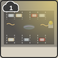 | gr\_parcheggio | Surface car park | 1 | 2 |
| 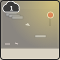 | gr\_piazzale | Tarmac square | 1 | 2 |
| 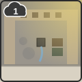 | gr\_cortile | Concrete courtyard | 1 | 2 |
| 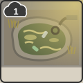 | gr\_laghetto | Polluted pond | 1 | 2 |
| 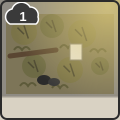 | gr\_bosco | Neglected woodland | 1 | 2 |
| 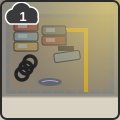 | gr\_sfasciacarrozze | Scrapyard | 1 | 2 |
| 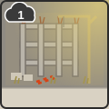 | gr\_cantiere | Abandoned building site | 1 | 2 |
| 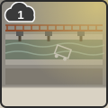 | gr\_argine | Concreted stream | 1 | 2 |
| 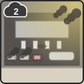 | gr\_distributore | Petrol station | 2 | 2 |
| 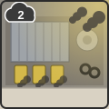 | gr\_deposito | Diesel bus depot | 2 | 2 |
| 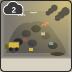 | gr\_discarica | Unsorted landfill | 2 | 2 |
| 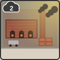 | gr\_fornace | Brick kiln | 2 | 2 |

**Surface car park.** Printed text: "An always-full tarmac car park that soaks up heat in summer and floods when it rains." Art: a rectangle of dark grey tarmac, cracked in several places, with the white lines of the parking bays faded and broken. Three rows of parked cars in dull colours (grey, beige, a faded red), a parking meter in the corner, a puddle with iridescent oil reflections. A stunted sapling with a few yellow leaves grows in a concrete planter. Wavy heat lines rise above the tarmac.

**Tarmac square.** Printed text: "A wide square with no shade, used for the market once a week and empty the rest of the time." Art: a vast surface of pale tarmac, glaring in the sun, with the folded frames of a few metal market stalls piled up on one side. A plastic bag carried by the wind, litter along the kerb, a crooked no-parking sign. No trees; a single concrete bench in the sun.

**Concrete courtyard.** Printed text: "A fully concreted inner courtyard where rainwater is not absorbed and runs straight into the sewer." Art: a courtyard enclosed on three sides by façades with peeling plaster, shuttered windows and satellite dishes. In the middle, a drain grate overflowing into a trickle of water; along one wall, rubbish bins and a rusty bicycle leaning against them. The floor is uniform grey concrete with damp stains.

**Polluted pond.** Printed text: "A forgotten pond covered in scum and litter, its still water no longer home to any life." Art: a stretch of murky, green-brown water with chipped concrete banks. Yellowish scum gathers along the edges; plastic bottles, a tyre and an upturned shopping trolley stick out of the water. Around it, dry reeds and a drainpipe pouring dark water into the pond. No animals, no reflection of the sky.

**Petrol station.** Printed text: "A petrol and diesel station with an endless queue of waiting cars." Art: a flat canopy on pillars, with four unbranded fuel pumps and a blank price board. A line of waiting cars puffing dark smoke from their exhausts, and a tanker manoeuvring. Oil stains and an abandoned jerry can on the forecourt.

**Diesel bus depot.** Printed text: "A depot of diesel buses that leave at dawn trailing a plume of smoke." Art: a shed with a corrugated-iron roof and a wide open door, out of which come three old-model buses in faded yellow, with black smoke from their exhausts. Next to it, a cylindrical diesel tank, stacked tyres and a workshop with tools in disarray.

**Neglected woodland.** Printed text: "A copse left to itself, choked by brambles and invasive plants and used as an illegal dump." Art: a dense patch of bare, crooked trees, with broken branches on the ground and a fallen trunk blocking a path that can no longer be seen. Brambles and tree-of-heaven invade every gap; black bin bags, a fridge and a mattress are dumped among the trunks. The foliage is a dull, almost grey green under the veil of yellowish haze.

**Scrapyard.** Printed text: "Piles of wrecked cars leaking oil and fluids into the ground." Art: a yard of packed earth fenced with corrugated sheets, with stacks of rusty car wrecks in dull colours. A magnet crane lifts a car; stacked tyres, heaps of doors and bumpers, iridescent oil stains on the ground.

**Abandoned building site.** Printed text: "The concrete skeleton of a block of flats never finished, standing still for years." Art: bare reinforced-concrete pillars and floors, with rusty rebar sticking out of the top. A motionless, faded crane, hardened cement bags, red-and-white barriers knocked to the ground and a faded site sign; weeds among the rubble.

**Concreted stream.** Printed text: "A stream boxed in by concrete walls, where water rushes away without soaking into the ground." Art: a straight channel with vertical banks of stained grey concrete, shallow murky water, a shopping trolley stuck on the bottom and drainpipes jutting out of the walls. A rusty railing runs along the edge; no plants.

**Unsorted landfill.** Printed text: "Heaps of unsorted rubbish that ferment and give off methane and smoke." Art: a hill of black bin bags and mixed waste, with a yellow bulldozer at work at its foot and seagulls in flight. On one side of the heap a small fire smoulders, sending up dark smoke; at the bottom, a pool of blackish leachate.

**Brick kiln.** Printed text: "An old brickworks with diesel-fired kilns that never go out." Art: a red-brick shed with the kiln mouths glowing orange and a tall chimney giving off black smoke. In the yard, stacked pallets of bricks and a diesel lorry being loaded; reddish dust veils the whole scene.

### 4.4 Building tiles

Building tiles are double-sided. The grey side emits 2 at the end of every year; the decarbonised side emits 0. Retrofitting a building costs 4 credits and means flipping the tile to its decarbonised side, which stays in the same space. Decarbonised buildings count for the Satellite monitoring bonus.

| Image | ID | Grey side | Decarbonised side | Emission grey / decarbonised | Retrofit cost | Copies |
| --- | --- | --- | --- | --- | --- | --- |
| 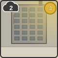 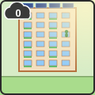 | ed\_condominio | 1960s apartment block | Retrofitted apartment block | 2 / 0 | 4 | 2 |
| 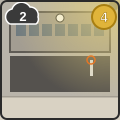 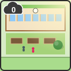 | ed\_scuola | School with oil boiler | Sustainable school | 2 / 0 | 4 | 2 |
| 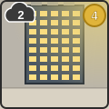 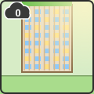 | ed\_uffici | Office block | High-efficiency offices | 2 / 0 | 4 | 2 |
| 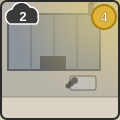 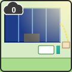 | ed\_capannone | Craft workshop | Solar workshop | 2 / 0 | 4 | 2 |

**1960s apartment block.** Printed text: "Six storeys of uninsulated walls and a central diesel boiler." Art: a six-storey residential block seen three-quarter on, with a grey façade streaked with grime and single-glazed aluminium windows, some of them open. Clothes horses, boxes and air conditioners hanging from the balcony railings; a plume of black smoke rises from the chimney on the roof.

**Retrofitted apartment block.** Printed text: "External insulation, a heat pump and solar panels on the roof." Art: the same building, with the façade finished in cream and terracotta render, new double-glazed windows and green planters on every balcony. On the flat roof, a neat row of solar panels and the outdoor unit of the heat pump; no smoking chimney. On one balcony, a figure watering the plants.

**School with oil boiler.** Printed text: "A primary school heated by an old boiler, with a fully tarmacked playground." Art: a low two-storey school building with long ribbon windows and a clock on the façade. The playground is tarmac, with a basketball hoop without a net; the boiler flue smokes on one side.

**Sustainable school.** Printed text: "A heat pump, a green roof and a playground turned into a teaching garden." Art: the same school with its roof covered in grass and small shrubs, wooden sunshades on the windows and the playground turned into a garden with raised beds, young trees and a gravel path where some children are playing.

**Office block.** Printed text: "A fully glazed façade, air conditioning always on and lights on even at night." Art: an eight-storey building of dark, reflective glass, with rows of air-conditioning units on the roof giving off heat waves. Every window is lit despite the daytime sky.

**High-efficiency offices.** Printed text: "Sunshades, insulating glass and solar panels built into the façade." Art: the same building with its façade screened by vertical slats of light wood, solar panels on the parapets and a green terrace on the top floor. Only a few windows are lit.

**Craft workshop.** Printed text: "A workshop with a sheet-metal roof and gas heating, open six days a week." Art: a rectangular shed with a grey sheet-metal sawtooth roof, a sliding door open onto a workshop, a diesel van parked outside and a smoking metal chimney.

**Solar workshop.** Printed text: "A solar roof that powers the workshop and supplies energy to the neighbours." Art: the same shed with every slope of its roof covered in solar panels, an electric van charging at a charge point and a stylised cable carrying energy to the nearby houses, drawn in miniature at the edge of the tile.

### 4.5 Infrastructure tiles

Infrastructure tiles form a shared deck of 36 tiles, divided into three families. They are built on a grey land tile, which is removed; the infrastructure does not emit. The family sets cost and income, while the subjects within a family have identical values and differ only in art and text. Grey tiles worth 2 and worth 1 accept any infrastructure: the emission reduction depends on the grey tile removed, the income on the infrastructure built.

| Family | Cost | Income | Role in the game | Copies |
| --- | --- | --- | --- | --- |
| Green | 1 | 0 | Nature-based solutions: cheap, no revenue, the fastest way to remove sources of emissions | 15 |
| Mobility | 2 | 1 | Sustainable transport services, earning revenue from tickets and passes | 12 |
| Energy | 3 | 2 | Renewable energy generation and storage, earning revenue from selling energy | 9 |

The background colour of the caption band identifies the family: grass green for Green, light blue for Mobility, sun yellow for Energy.

| Image | ID | Name | Family | Copies |
| --- | --- | --- | --- | --- |
| 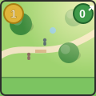 | inf\_parco | Urban park | Green | 4 |
| 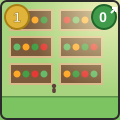 | inf\_orto | Community garden | Green | 4 |
| 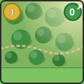 | inf\_bosco | Urban woodland | Green | 4 |
| 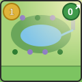 | inf\_giardino | Rain garden | Green | 3 |
| 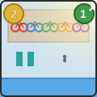 | inf\_ciclostazione | Bike station | Mobility | 3 |
| 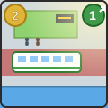 | inf\_bus | Electric bus stop | Mobility | 3 |
| 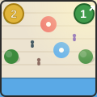 | inf\_pedonale | Pedestrian zone | Mobility | 3 |
| 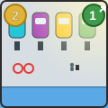 | inf\_condivisa | Shared mobility | Mobility | 3 |
| 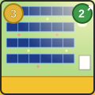 | inf\_fotovoltaico | Solar farm | Energy | 3 |
| 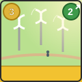 | inf\_eolico | Urban micro-wind | Energy | 3 |
| 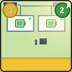 | inf\_accumulo | Community storage | Energy | 3 |

**Urban park.** Printed text: "Grass, trees and benches where there used to be concrete." Art: a bright green lawn crossed by a curving path of pale gravel, with three large, broad-crowned trees casting soft shadows. Wooden benches, a small drinking fountain, a person walking a dog and a child on a bicycle.

**Community garden.** Printed text: "Vegetable plots tended by the district's residents, with a shared compost bin." Art: rectangular raised beds edged with wood, full of recognisable vegetables (tomatoes on stakes, lettuces, pumpkins). A tool shed, a box composter, a rainwater tank and two figures bent over working the soil.

**Urban woodland.** Printed text: "A small wood of native species that gives shade and keeps water in the soil." Art: a dense patch of trees of different heights (oaks, maples, hornbeams) with an understorey of shrubs, a packed-earth path and a wooden boardwalk. Birds flying above the treetops, a nest visible among the branches.

**Rain garden.** Printed text: "A planted hollow that collects rainwater and slowly returns it to the ground." Art: a gentle hollow in the ground, with marsh plants, irises and tall grasses, a film of clear water at the bottom and stones along the edges. A downpipe from a neighbouring building empties water into the hollow; a few dragonflies above the water.

**Bike station.** Printed text: "Secure bicycle parking with a repair shop and charging points for e-bikes." Art: a wood-and-glass shelter with rows of racks full of colourful bicycles, a small workbench with an upturned bike being repaired, charging posts and a person unlocking their bike.

**Electric bus stop.** Printed text: "A covered stop with electric buses every ten minutes and a live arrivals board." Art: a shelter with a green roof and an illuminated board, a white-and-green electric bus at the stop with its charging pantograph lowered, passengers boarding, a bus lane marked in red.

**Pedestrian zone.** Printed text: "A street given back to pedestrians, with trees, seating and outdoor tables." Art: a car-free street paved in pale stone, with a row of trees, benches, café tables under umbrellas, people on foot, a pushchair and a street performer.

**Shared mobility.** Printed text: "Shared electric cars and bicycles, booked from your phone." Art: a small square with four compact, colourful electric cars parked at charge points, a bike-sharing station and an e-scooter; a person unlocking a car with their phone.

**Solar farm.** Printed text: "Solar panels on reclaimed land, with a wildflower meadow between the rows." Art: tilted rows of dark blue solar panels, with a flowering meadow between the rows where a few sheep graze. A white electrical substation in the corner and the sun reflected on the panels.

**Urban micro-wind.** Printed text: "Small vertical-axis wind turbines, quiet and suited to the city." Art: three white, helical vertical-axis turbines on medium-height poles, their moving blades suggested by curved lines. At the base, a lawn and a footpath with a person looking up.

**Community storage.** Printed text: "Shared batteries that store the energy produced by day for use in the evening." Art: two white containers bearing the stylised symbol of a charged battery, connected by cables to panels on the roofs of the nearby houses, drawn in miniature. A small green light on each container, a control panel with a technician.

### 4.6 Network tiles

Network tiles are rectangular, as long as the side of a district tile and a third as wide; two tiles side by side (road on the outside, railway on the inside) fill one side of the ring. Each tile has two faces: the run-down side emits 1 at the end of every year, the renewed side emits 0. Renewing a section costs 2 credits and means flipping the tile. When every section of a network has been renewed, the network is completed and every district reduces its emissions by 1 for the rest of the game.

| Image | ID | Type | Run-down side | Renewed side | Emission | Renewal cost | Copies |
| --- | --- | --- | --- | --- | --- | --- | --- |
| 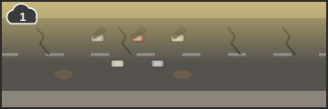<br>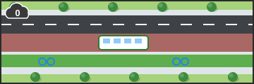 | rete\_strada\_\<district> | Road | Run-down road | Renewed road | 1 / 0 | 2 | 1 per district |
| 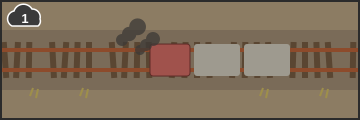<br>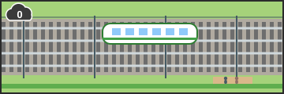 | rete\_ferrovia\_\<district> | Railway | Neglected railway | Renewed railway | 1 / 0 | 2 | 1 per district |

**Run-down road.** Printed text: "Cracked tarmac, potholes and traffic jams at every hour of the day." Art: a two-lane road running the length of the tile, joining the neighbouring districts at the edges. The tarmac is dark grey, scored with cracks and potholes full of muddy water, the road markings almost worn away. Cars queue bumper to bumper, smoking from their exhausts; a street lamp has a broken bulb, the pavement is chipped, and along the verge there is litter, bottles and a bent road sign. A cloud of yellowish smog hangs over the carriageway.

**Renewed road.** Printed text: "A protected cycle lane, trees along both sides and electric buses." Art: the same road with smooth, dark tarmac, a single lane for cars, a bus lane with an electric bus passing and a green cycle lane separated by a kerb, with a few cyclists. A row of trees and LED street lamps on both sides, wide clean pavements, clearly marked pedestrian crossings; the sky is clear.

**Neglected railway.** Printed text: "Rusty rails, rotten sleepers and diesel trains that are always late." Art: a single track with rust-coloured rails and rotten or missing wooden sleepers, the ballast overrun by weeds and litter. An old, faded red diesel locomotive pulls two dusty carriages, leaving a trail of black smoke; along the line, a wall covered in graffiti and an abandoned signal box with broken windows.

**Renewed railway.** Printed text: "New tracks, an electrified line and a train every fifteen minutes." Art: a shiny double track on clean ballast, overhead-line masts at regular intervals and a modern white-and-green electric train with its pantograph raised. Halfway along the tile, a small halt with a shelter, a bench and waiting passengers; along the line, a hedge and a footpath and cycle path.

### 4.7 Investment cards

Investment cards represent public policies the district funds in addition to its interventions on the ground. There are six types, one copy of each. At the start of the game, as many as the number of players plus one are turned face up at random; the others go back in the box. They are bought with the Public Works Councillor; each player may own at most two and they cannot be transferred. They score only at the end of the game, before any halving.

| Image | ID | Name | Cost | End-of-game points |
| --- | --- | --- | --- | --- |
| 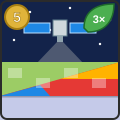 | sat\_monitoraggio | Satellite monitoring | 5 | 4 for each decarbonised building in your district (8 at most) |
| 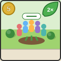 | inv\_partecipazione | Civic participation | 5 | 2 for each Green infrastructure in your district (8 at most) |
| 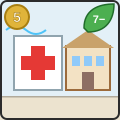 | inv\_sanita | Health and education | 5 | 7 minus your district's emissions (0 at least) |
| 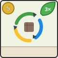 | inv\_circolare | Circular economy | 5 | 3 for each area worth 2 transformed with a Mobility or Energy infrastructure (6 at most) |
|  | inv\_patto | Covenant of Mayors | 4 | If the city reaches the threshold: 4, plus 2 for each year ahead of 2030 (8 at most) |
| 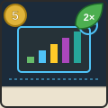 | inv\_digitale | Digital city and open data | 5 | 2 for each kind of intervention done at least once: Green, Mobility, Energy, retrofitted building, renewed network section (10 at most) |

Role in the game: each card rewards a different choice. Satellite monitoring and Circular economy push towards the more expensive interventions, Civic participation towards cheap Green, Health and education rewards the final result, Digital city a balanced transformation, Covenant of Mayors cooperation to reach the threshold early. Simulations suggest a typical value of 4–7 points per card bought.

The cards share the same layout as the satellite tile: cost coin in the top left corner, points leaf in the top right corner, caption band with name and printed text.

**Satellite monitoring.** Printed text: "The satellite watches the district's roofs and heat and certifies its decarbonised buildings." Art: in the upper half, an Earth-observation satellite with two wings of blue solar panels and a cylindrical sensor pointing downwards, against a night-blue background dotted with stars. In the lower half, the plan of a neighbourhood seen from above, split diagonally: the left part in natural colours, the right part in thermal false colours, from the blue of green areas to the red of hot roofs. A faint beam of light links the sensor to the plan. The cost coin in the top left corner, the leaf with the label "4 × building" in the top right corner.

**Civic participation.** Printed text: "Neighbourhood assemblies and care agreements: residents look after the green spaces." Art: a small public lawn where a group of residents of different ages plants a tree and tends a flower bed; an outdoor table with sheets of paper and a colourful poster, children watering, a freshly painted bench. Morning light, full colours.

**Health and education.** Printed text: "Cleaner air, less illness: clinics and schools measure the benefits in the district." Art: a neighbourhood clinic with a red cross on its façade next to a school with open windows; in front, children playing outdoors and a doctor talking with a family. In the sky, a stylised air-quality gauge pointing to green.

**Circular economy.** Printed text: "Reuse, recycling and recovered materials: the worst polluters become resources." Art: a reuse centre in a former shed, with shelves of repaired objects, refurbished bicycles and bales of recycled materials; in the middle, the three chasing recycling arrows in green, blue and yellow.

**Covenant of Mayors.** Printed text: "The city commits, together with other European cities, to cutting its emissions." Art: on a blue background, the circle of twelve yellow stars with two hands shaking in the middle; below, in miniature, the outlines of a few European cities linked by a dotted line.

**Digital city and open data.** Printed text: "Sensors and open data show everyone, in real time, how the district is changing." Art: a large public screen in a square showing colourful bar charts and a map of the neighbourhood; sensors on the street lamps, a young person checking the data on their phone, glowing lines linking the buildings to the dashboard.

### 4.8 Role cards

Role cards are portrait cards with the illustration in the upper part and, below it, the role's name, the action for everyone and the privilege of whoever chooses it. Credits from roles not chosen pile up on the cards.

| Image | ID | Role | Action for everyone | Privilege |
| --- | --- | --- | --- | --- |
| 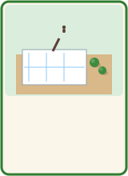 | ruolo\_urbanista | Urban Planner | Build an infrastructure on a grey land tile | −1 to the cost |
| 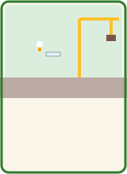 | ruolo\_lavori | Public Works Councillor | Retrofit a building, or renew a network section, or buy an Investment card | −1 to the cost |
| 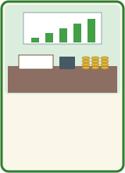 | ruolo\_bilancio | Budget Councillor | Collect infrastructure income | +1 credit |
| 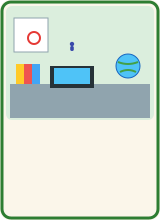 | ruolo\_progettista | EU Grant Writer | None | 2 credits |
| 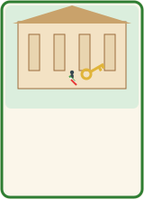 | ruolo\_sindaco | Mayor | None | 1 credit and the Key to the City |

Art:

- **Urban Planner**: a figure bent over a large drawing table, with a city plan unrolled, set squares and pencils, and a scale model with miniature trees.
- **Public Works Councillor**: a figure in a white hard hat and high-visibility vest in front of a building site, with a crane and a roll of plans under their arm.
- **Budget Councillor**: a desk with an open ledger, a calculator, coins in neat stacks and a rising bar chart hanging on the wall.
- **EU Grant Writer**: a figure at a laptop surrounded by folders, with a globe and a calendar with a deadline circled.
- **Mayor**: a figure wearing the mayoral sash on the threshold of a town hall, holding a large golden key.

### 4.9 Tokens

- **Network completed, road** and **Network completed, railway**: green discs showing the renewed road or railway in miniature, with the crossed-out cloud and the label −1. They are placed next to the city emissions track when the corresponding network is completed.
- **Key to the City**: a stylised golden key; it marks the first player of the year.
- **Year marker**: a small white disc that moves along the year track from 2025 to 2030.
- **Emissions cubes** and **score pawns**: in the four district colours (brick red, light blue, ochre, bottle green).

## 5. Setup

1. Choose the districts in play: Castle, Bridge and Market with 3 players, all four with 4 players. Each player takes a district with the cube and pawn of the matching colour.
2. Assemble the ring as described in section 3, with every road and railway tile on its run-down side.
3. Sort the grey land tiles by the value on their back and shuffle them face down. Each player draws four tiles worth 1 and two worth 2 and places them at random on squares T1-T6. With 3 players the remaining tiles go back in the box.
4. Shuffle the eight building tiles in a bag and assign two at random to each district, on squares E1 and E2, grey side up. With 3 players the two remaining tiles go back in the box.
5. Each player places their cube on 14 on their personal emissions track. Mark the total on the city track (42 with 3 players, 56 with 4) and place the threshold marker on 10 with 3 players or 13 with 4 players.
6. Each player receives 3 credits; the score pawns start at 0.
7. Shuffle the infrastructure deck and turn face up in the middle as many tiles as the number of players plus one (4 with 3 players, 5 with 4).
8. Place the five role cards, without credits, and the two Network completed tokens in the middle. Shuffle the six Investment cards and turn face up as many as the number of players plus one; the others go back in the box.
9. Place the Year marker on 2025. Give the Key to the City to a player chosen at random.

## 6. Rules

### 6.1 Playing a year

The game lasts at most six years, from 2025 to 2030. Each year has two phases: choosing roles and closing the year.

**Phase A, choosing roles.** Starting with the player holding the Key to the City and going clockwise, each player chooses a role card from those not yet chosen this year. Whoever chooses a role takes all the credits piled up on the card. The role is carried out at once: every player performs the action for everyone, one at a time, starting with the player who chose the role and then clockwise; the player who chose the role also applies the privilege. Only after everyone has performed the action does the next player choose their role. The phase ends when every player has chosen a role; so two roles are left unchosen with 3 players and one with 4.

**Phase B, closing the year.** Carry out the following steps in order.

1. **Pile-up.** Add 1 credit from the supply to each role card not chosen this year.
2. **Emissions.** Each district works out its emissions (formula in section 6.3) and updates the cube on its personal track. Add up the city total and update the city track.
3. **Points.** Each player scores impact points equal to 14 minus the current emissions of their district and moves their pawn along the score track.
4. **End check.** If the city's emissions are at or below the threshold, or if the year just closed is 2030, the game ends (section 8).
5. **Preparing the next year.** The infrastructure tiles left face up go to the discard pile and new ones are turned face up, as many as the number of players plus one; if the deck runs out, shuffle the discard pile to form a new one. If nobody chose the Mayor, the Key to the City passes to the player on the left of whoever held it. The Year marker moves forward one space.

### 6.2 The roles

**Urban Planner.** In turn, each player may take one of the face-up infrastructure tiles, pay its cost and build it on a grey land tile of their district. The covered grey tile is removed from the game. The player who chose the role pays 1 credit less (minimum cost 0). A player may pass, and must do so if they do not have enough credits, have no grey land tiles left or the face-up tiles have run out. The display is not refilled during the year.

**Public Works Councillor.** In turn, each player may take only one of the following actions, or pass:

- retrofit one of their grey buildings, paying 4 credits and flipping the tile to its decarbonised side;
- renew one of their district's two network sections that is still run-down, paying 2 credits and flipping the tile to its renewed side;
- buy a face-up Investment card that nobody has taken yet, paying its cost, if they own fewer than two cards; the card is placed next to the buyer's district.

The player who chose the role pays 1 credit less for the chosen action. When a player renews the last run-down section of a network, the network is completed and the matching Network completed token is immediately placed next to the city track.

**Budget Councillor.** Each player collects as many credits as the total income of the infrastructure built in their district (0 for each Green, 1 for each Mobility, 2 for each Energy). The player who chose the role collects 1 credit more.

**EU Grant Writer.** The player who chose the role collects 2 credits. The other players take no action.

**Mayor.** The player who chose the role collects 1 credit and takes the Key to the City, which makes them first player in the following year. The other players take no action.

### 6.3 Working out emissions

A district's emissions, worked out at the end of every year, are the sum of:

- the value of each grey land tile still present (1 or 2);
- 2 for each building still on its grey side;
- 1 for each of its own network sections still run-down;

minus 1 for each completed network (2 at most). The result cannot go below 0. The city's emissions are the sum of the emissions of all the districts.

A district that has not yet renewed its section keeps paying its emission and prevents the whole city from getting the network completed bonus; the penalty for the delay therefore falls first of all on whoever causes it.

### 6.4 Detailed rules

- A player's credits cannot go below 0 and there are no loans.
- Credits on the role cards pile up without limit.
- Removed grey tiles and retrofitted buildings never go back to their initial state.
- Each player may only renew their own two network sections, one at a time.
- Investment cards cannot be transferred; each player owns two at most.
- All information is public: every player's credits, points and tiles are visible to everyone.

### 6.5 Time per move

Every time a player has to make a decision (choose a role, or carry out their action as Urban Planner or Public Works Councillor) they have a time limit, set at the start of the game: 2 minutes unless agreed otherwise, or no limit. Once the time limit is exceeded, the player loses 1 impact point every 10 seconds until they make their move. The penalty is subtracted from the score at once and does not change the emissions of the district or of the city. In the app the clock stops while a window is open (year summary, rules) and restarts from zero at every new decision.

## 7. Scoring

Impact points are scored in two ways.

- **At the end of every year**, each player scores 14 minus the current emissions of their district, that is the total reduction achieved since the start of the game, including the bonus from completed networks. The value ranges from 0 (no interventions) to 14 (zero-emission district).
- **At the end of the game**, each player adds the points from their Investment cards (section 4.7).
- **Time penalty**: 1 point for every 10 seconds over the time limit per move (section 6.5), subtracted at once.

If the city failed the cooperative goal, each player's total, including the points from Investment cards, is halved and rounded down.

## 8. Winning and losing

**Collective success.** If at the end of a year the city's emissions are at or below the threshold (10 with 3 players, 13 with 4), the game ends at once with the city's success, even before 2030. Scores stay whole.

**Collective failure.** If at the end of 2030 the city's emissions are above the threshold, the city has failed its goal and every score is halved.

**Individual winner.** In both cases the player with the highest final score wins. Ties are broken in favour of the player with the lowest emissions in their district, then the one with more credits; if still tied, the victory is shared. The city's result is announced together with the ranking, because an individual victory in a city that failed is only a partial result.

## 9. Game dynamics

**Timing matters.** Since points are scored every year according to the accumulated reduction, an intervention is worth more the earlier it is made. In the first years it pays to spend the whole budget on reductions, even at the expense of income.

**Where to build infrastructure.** The reduction depends on the grey tile removed and not on the infrastructure built, so a 1-credit Green on a Petrol station reduces emissions by 2. The more expensive infrastructure is justified by its income, which only helps if the Budget Councillor will be chosen several times in the rest of the game.

**Choosing roles.** Every role helps everyone, but whoever chooses it gets the privilege and decides when the action happens. Choosing the Urban Planner when your opponents have no credits means using the display almost alone; choosing the Budget Councillor when you have more income than the others widens the gap. Roles that are ignored pile up credits and become more and more attractive.

**Networks.** Renewing your own section immediately earns 1 point a year and brings the network completed bonus closer, which is worth 1 point a year to each player. Delaying the renewal to deny the bonus to the others costs the latecomer more than it costs their opponents, because they lose both the bonus and the reduction from their own section.

**Investments.** Each Investment card is usually worth 4–7 points to whoever buys it: it pays when it rewards something the player is already doing, or can still do in the remaining years. A single copy of each card and a maximum of two per player mean that nobody can corner every source of end-of-game points. The Covenant of Mayors pays only if the city reaches the threshold: it is a bet on cooperation.

**Cooperation and competition.** The leading player has an interest in reaching the threshold early to end the game while ahead. Those behind cannot hold the city back without giving up their own points, and a collective failure halves everyone's score without changing the order of the ranking; the only effective way to catch up is to cut your own emissions faster than the others.

## 10. Examples of play

The examples follow a 3-player game: Anna governs the Castle, Bruno the Bridge, Carla the Market, seated in this order clockwise. Anna therefore owns the network sections between Castle and Bridge, Bruno those between Bridge and Market, Carla those between Market and Castle. The city threshold is 10. Examples 10.2 and 10.3 are the full sequence of the first two years and can serve as test cases for the app.

### 10.1 Setting up Anna's district

Anna's grey tiles, placed at random, are: T1 Petrol station (2), T2 Surface car park (1), T3 Polluted pond (1), T4 Diesel bus depot (2), T5 Tarmac square (1), T6 Concrete courtyard (1). From the bag she draws the 1960s apartment block (E1) and the School with oil boiler (E2). Emissions are 8 from the land tiles, 4 from the buildings and 2 from the network sections, for a total of 14. Anna holds the Key to the City. Each player has 3 credits.

### 10.2 Year 2025

Display: Urban park, Community garden, Electric bus stop, Solar farm.

**Anna chooses the Urban Planner.** Anna, using the privilege, takes the Electric bus stop paying 1 credit instead of 2 and builds it on the Petrol station, which is removed. Bruno takes the Urban park (1 credit) and builds it on his Diesel bus depot. Carla takes the Community garden (1 credit) and builds it on her Surface car park. The Solar farm, which costs 3, stays in the display. Credits: Anna 2, Bruno 2, Carla 2.

**Bruno chooses the Public Works Councillor.** Bruno renews his road paying 1 credit thanks to the privilege and flips the tile. Carla renews her railway (2 credits). Anna renews her road (2 credits). No network is completed, because Carla's road is missing. Credits: Anna 0, Bruno 1, Carla 0.

**Carla chooses the EU Grant Writer** and collects 2 credits. Credits: Anna 0, Bruno 1, Carla 2.

**Closing the year.** Budget Councillor and Mayor were not chosen and receive 1 credit each. The Solar farm goes to the discard pile. Nobody chose the Mayor, so the Key passes from Anna to the player on her left, Bruno.

| Player | Credits | Emissions | Points this year | Total |
| --- | --- | --- | --- | --- |
| Anna | 0 | 11 | 3 | 3 |
| Bruno | 1 | 11 | 3 | 3 |
| Carla | 2 | 12 | 2 | 2 |

City emissions: 34, above the threshold; the game goes on. Anna's emissions are 11: her five remaining grey tiles are worth 6, the two buildings 4, the railway still run-down 1.

### 10.3 Year 2026

Display: Urban woodland, Rain garden, Bike station, Urban micro-wind. Bruno holds the Key.

**Bruno chooses the Budget Councillor.** He takes the credit piled up on the card (2 credits). The action starts with Bruno: Bruno has only a Green, income 0, and collects 1 credit for the privilege; Carla has only a Green and collects nothing; Anna has the Electric bus stop and collects 1 credit. Credits: Anna 1, Bruno 3, Carla 2.

**Carla chooses the Mayor.** She takes the piled-up credit and the role's credit, going up to 4, and takes the Key to the City.

**Anna chooses the Urban Planner.** Anna takes the Urban woodland, which thanks to the privilege costs her 0, and builds it on the Tarmac square. Bruno takes the Bike station (2 credits) and builds it on his Petrol station, worth 2, also gaining future income. Carla takes the Rain garden (1 credit) and builds it on her Diesel bus depot. Carla could have paid for the Urban micro-wind, but prefers the Rain garden, which costs 1 and still removes a tile worth 2; the Urban micro-wind stays in the display. Credits: Anna 1, Bruno 1, Carla 3.

**Closing the year.** Public Works Councillor and EU Grant Writer receive 1 credit each. The Key stays with Carla, who chose the Mayor.

| Player | Credits | Emissions | Points this year | Total |
| --- | --- | --- | --- | --- |
| Anna | 1 | 10 | 4 | 7 |
| Bruno | 1 | 9 | 5 | 8 |
| Carla | 3 | 10 | 4 | 6 |

City emissions: 29.

### 10.4 Completing a network (year 2028)

At the start of 2028 emissions are Anna 7, Bruno 7, Carla 8. Carla's railway has been renewed since 2025; Anna's and Bruno's are missing. During the year Bruno builds a Green on his Concrete courtyard; then, with the Public Works Councillor, Anna renews her railway and Bruno, last, renews his. With the last tile flipped the railway network is completed and the matching token is placed. Carla, who spent her credits on a Green, does not renew her road, which remains the only run-down road section.

Before the bonus, emissions would be Anna 6, Bruno 5, Carla 7. The network completed bonus reduces each by 1: Anna 5, Bruno 4, Carla 6, for a city at 15. Points for the year are Anna 9, Bruno 10, Carla 8.

Had Bruno chosen not to renew his railway, emissions would have been Anna 6, Bruno 6, Carla 7. Bruno would have lost 2 points that year (1 for the run-down section and 1 for the missing bonus), Anna and Carla 1 each. The same now applies to Carla: until she renews her road, she is the one who loses more than the others.

### 10.5 End of the game

In 2029 Carla buys Satellite monitoring and retrofits both her buildings. (This example predates the Investment cards and uses the old satellite rule: 3 points per building; it serves as a test case for the final calculation.) At the end of 2029 emissions are Anna 3, Bruno 3, Carla 5, for a city at 11, just above the threshold; the game goes on. At the end of 2030 emissions are Anna 2, Bruno 3, Carla 4, for a city at 9: the threshold is reached and the city succeeds.

| Player | 2025 | 2026 | 2027 | 2028 | 2029 | 2030 | Satellite | Total |
| --- | --- | --- | --- | --- | --- | --- | --- | --- |
| Anna | 3 | 4 | 7 | 9 | 11 | 12 | — | 46 |
| Bruno | 3 | 5 | 7 | 10 | 11 | 11 | — | 47 |
| Carla | 2 | 4 | 6 | 8 | 9 | 10 | 6 | 45 |

Bruno wins with 47 points. Carla, who had the lowest yearly scores, makes up almost all of the gap thanks to the satellite and her two decarbonised buildings.

**Failure variant.** Suppose instead that at the end of 2030 the city is at 12 (Anna 3, Bruno 4, Carla 5) and that the totals, satellite included, are Anna 44, Bruno 45, Carla 43. The failure halves the scores, rounding down: Anna 22, Bruno 22, Carla 21. Between Anna and Bruno, tied on points, Anna wins the tie because she has the lower emissions.

## 11. Notes for the HTML5 implementation

This section turns the rules into guidance for developing the app. In case of conflict, sections 5-8 prevail.

### 11.1 Scope

- Single-page app in HTML5, CSS and JavaScript, running in a browser with no server; no data sent over the network.
- Game mode: 3 or 4 human players on the same device, taking turns (hot seat). Computer-controlled opponents and online play are not planned in this version.
- Interface language: English and Italian, with every string (names, printed texts, messages) collected in a single resource file per language, to make later translations easier.
- Graphics: each tile is an image identified by its catalogue ID, with the suffix `_front` and `_back` for double-sided tiles (for example `ed_scuola_front.svg`, `ed_scuola_back.svg`, `rete_strada_back.svg`). A first version can use vector placeholders in the palette colour given in section 4.1, with the name and value icons; the illustrations described in section 4 will replace them without changing the code.

### 11.2 Constants

| Constant | Value |
| --- | --- |
| Players | 3 or 4 |
| Years | 2025-2030 (6) |
| Starting credits | 3 |
| Starting emissions per district | 14 |
| City threshold | 10 with 3 players, 13 with 4 |
| Face-up tiles per year | number of players + 1 |
| Green cost / income | 1 / 0 |
| Mobility cost / income | 2 / 1 |
| Energy cost / income | 3 / 2 |
| Building retrofit cost | 4 |
| Network section renewal cost | 2 |
| Face-up Investment cards | number of players + 1 |
| Investment cards per player | 2 at most |
| Investment card costs and points | table in section 4.7 |
| Privilege discount (Urban Planner, Public Works) | 1, minimum cost 0 |
| Budget privilege bonus | +1 |
| EU Grant Writer credits | 2 |
| Mayor credits | 1 |
| Pile-up per unchosen role | 1 per year |
| Network completed bonus | −1 emission per district, per network |
| Failure factor | 0.5, rounded down |
| Time limit per move | 120 seconds, adjustable at the start of the game; 0 = no limit |
| Time penalty | 1 point every 10 seconds over the time limit |

It is best to collect these values in a single configuration object, as they will be tuned through playtesting.

### 11.3 Data model

Indicative structure of the game state (identifiers stay in Italian, as in the code):

```
GameState {
  seed: number                     // reproducible random generator
  playerCount: 3 | 4
  year: 2025..2030
  phase: 'SETUP' | 'ROLE_SELECTION' | 'ROLE_EXECUTION' | 'YEAR_END' | 'GAME_OVER'
  keyHolder: playerIndex           // Key to the City
  chooserIndex: playerIndex        // who must choose the role
  activeRole: RoleId | null
  executionQueue: playerIndex[]    // execution order of the current action
  rolesChosenThisYear: RoleId[]
  roleCredits: { [RoleId]: number }
  infraDeck: InfraTileId[]
  infraDisplay: InfraTileId[]
  infraDiscard: InfraTileId[]
  investmentsOnTable: InvestmentId[]
  investmentOwners: { [InvestmentId]: playerIndex | null }
  successYear: number | null       // year in which the city reached the threshold
  networkCompleted: { strada: boolean, ferrovia: boolean }
  players: Player[]
  log: LogEntry[]
  outcome: null | { citySuccess: boolean, finalScores: number[], ranking: playerIndex[] }
}

Player {
  name: string
  municipio: 'castello' | 'ponte' | 'mercato' | 'stazione'
  credits: number
  score: number
  emissions: number                // recalculated at every year end
  territorial: Slot[6]             // T1..T6
  buildings: Slot[2]               // E1..E2
  network: { strada: 'dissestata' | 'rinnovata', ferrovia: 'dissestata' | 'rinnovata' }
}

Slot =
  | { kind: 'grigia', tileId: GreyTileId, emission: 1 | 2 }
  | { kind: 'infrastruttura', tileId: InfraTileId, family: 'verde' | 'mobilita' | 'energia' }
  | { kind: 'edificio', tileId: BuildingTileId, side: 'grigio' | 'decarbonizzato' }

RoleId = 'urbanista' | 'lavori' | 'bilancio' | 'progettista' | 'sindaco'
```

The owner of the network sections is the player's district: on screen, a player's sections are drawn on the side of the ring linking their district to the next one clockwise.

### 11.4 Game flow

1. **SETUP**: choose the number and names of the players, initialise the random generator, carry out the setup in section 5 and give the Key to a random player. To reproduce the examples in section 10 it must be possible to force the initial layout of the tiles and the order of the deck.
2. **ROLE\_SELECTION**: player `chooserIndex` chooses a role not in `rolesChosenThisYear`; they collect `roleCredits[role]`, which goes back to 0. Build `executionQueue` starting from the chooser, clockwise. For EU Grant Writer and Mayor the queue holds only the chooser.
3. **ROLE\_EXECUTION**: each player in the queue performs the action or passes; the interface shows only the allowed options. When the queue is empty, if everyone has chosen a role move to YEAR\_END, otherwise `chooserIndex` moves on clockwise and go back to ROLE\_SELECTION.
4. **YEAR\_END**: pile-up on unchosen roles, emissions calculation, points, end check; if the game goes on, refill the display, pass the Key if the Mayor was not chosen, advance the year, `chooserIndex = keyHolder`.
5. **GAME\_OVER**: Investment card points, halving if needed, ranking with the tie-breaks in section 8.

### 11.5 Validity checks

- A role already chosen this year cannot be selected.
- Urban Planner: the action is allowed only if there are face-up tiles, a free grey land tile and enough credits for at least one face-up tile, after the discount if the player is the one who chose the role.
- Public Works: one action per player; retrofit only on one of your own grey buildings; renewal only on one of your own run-down sections; Investment card only if it is face up, not yet taken and the player owns fewer than two.
- After each renewal, check whether every section of that type has been renewed; if so `networkCompleted` becomes true and the event is recorded in the log.
- Emissions are worked out with the formula in section 6.3, minimum 0; the year's points are `14 − emissions`.
- Credits cannot become negative.

### 11.6 Interface

- The board takes up the centre of the screen and reproduces the ring in section 3. The elements that sit in the middle of the ring on the table (display, role cards with their piled-up credits, Investment cards, network tokens, year track, city track with the threshold highlighted) are in a common area to the left of the board, or above it on narrower screens; the ring is therefore as narrow as the network tiles, and the districts are larger.
- A button opens the players' rules, in Italian and English.
- The current player's panel shows the time left for the move and, past the limit, the penalty accrued.
- Tiles that change state (building an infrastructure, retrofitting a building, renewing a section) have a short animation: the removed grey tile fades out, double-sided tiles flip.
- On hover, or with a long press on touch screens, each tile shows its name, printed text and values.
- A panel for each player shows credits, current emissions, points and total income; the current player is highlighted.
- A text log lists the actions of the current year, useful for checking the rules during playtests.
- The final screen shows the city's result, the ranking, each player's points per year and the points from Investment cards.
- Game values must never rely on colour alone: icons and numbers are always visible.

### 11.7 Test cases

With the tile layout and order in section 10, the app must reproduce exactly the end-of-year tables for 2025 and 2026 (credits, emissions, points) and the emissions calculation in example 10.4, including the alternative case in which Bruno does not renew his railway. The final score in section 10.5 and its failure variant are used to check end-of-game points, halving and tie-breaks.
